# Proof of progress: Tryout Evidence Cards

This document shows the working web app, step by step, with a real screenshot for each step and a plain explanation of what is happening behind it.

**What the app is for:** a youth soccer coach runs a tryout with many players and little time. They film short clips on a phone. The app turns each clip into an *evidence card* (timestamped observations with confidence values and a "Can't tell" option) and puts several players side by side in one comparison table that can be shared with selectors.

**How the screenshots were taken:** all of them are from the real app running on the developer's computer (`localhost:3000`), using the built-in demo clips (two kids' football clips from Wikimedia Commons, CC BY-SA 4.0) and a sample roster. The AI results are real, not mocked up.

---

## The journey in 11 screenshots

### 1. The home screen
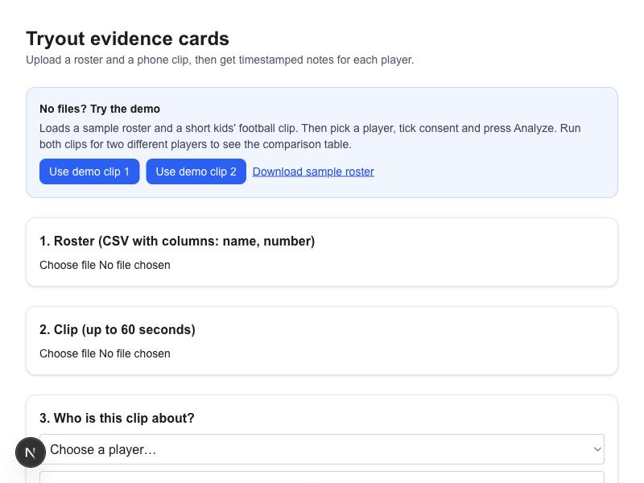

**What you see:** one page with three steps (roster, clip, who is this about) and a blue "No files? Try the demo" box on top.

**What it does:** this is the only screen a coach uses. The demo box exists so anyone can try the app without having their own roster or video. The "Download sample roster" link gives a file in the right format.

---

### 2. A wrong roster file is rejected
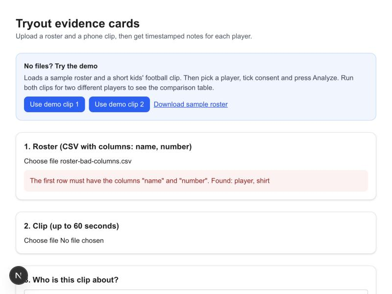

**What you see:** a red message: *The first row must have the columns "name" and "number". Found: player, shirt.*

**What it does:** the roster is checked by ordinary code (no AI). It checks the file type, that the right columns exist, that no row is blank, and that no name or number appears twice. A bad file gives a specific message and loads nothing, so the app never works from a broken player list. This covers part of **Test 3 (handle bad input)**.

---

### 3. Roster and clip loaded
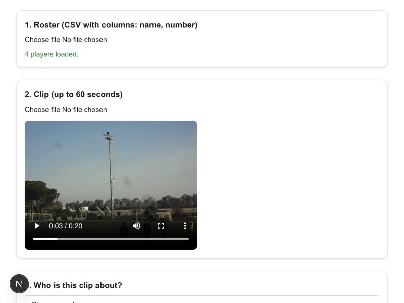

**What you see:** "4 players loaded." in green, and the video preview (0:03 of 0:20).

**What it does:** pressing "Use demo clip 1" loads the sample roster and the clip. Behind the scenes, the browser pulls 8 still frames out of the video, each stamped with its time, and shrinks them. A whole video is never sent anywhere. Only these small frames are, which keeps the upload fast and under the hosting size limit. Clips longer than 60 seconds are refused.

---

### 4. The Analyze button is blocked until everything is filled in
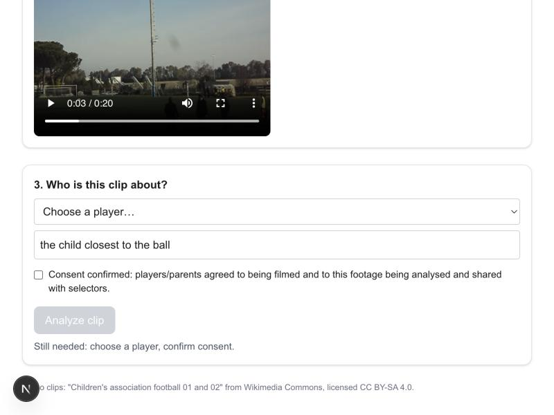

**What you see:** a grey, disabled button and the line *Still needed: choose a player, confirm consent.*

**What it does:** the coach must pick a player from the dropdown, describe how to spot them (for example "red bib, left wing"), and tick the consent box. Without a player, the app has no way to know whose actions it is describing, so it refuses to guess. The server repeats these checks, so they cannot be skipped. This covers the "omit a player assignment" case in **Test 3**.

---

### 5. Ready to analyze
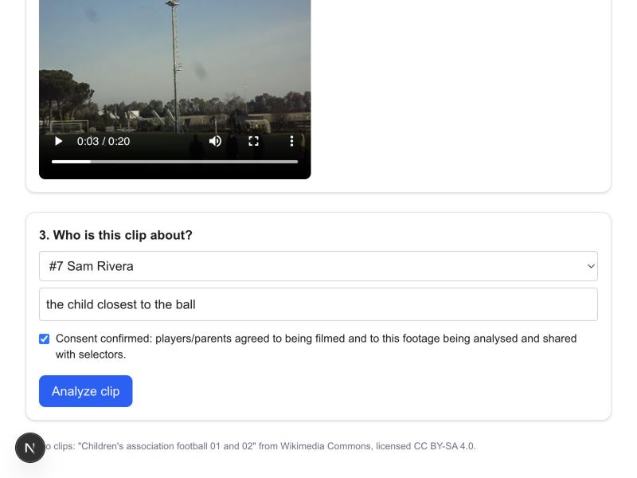

**What you see:** "#7 Sam Rivera" chosen, the description "the child closest to the ball", consent ticked, and a blue "Analyze clip" button.

**What it does:** the description replaces automatic bib or face matching (which is out of scope). The AI is told to describe only the player matching that description. The consent tick is a manual checkbox, as the brief allows.

---

### 6. Unclear footage is flagged instead of guessed at
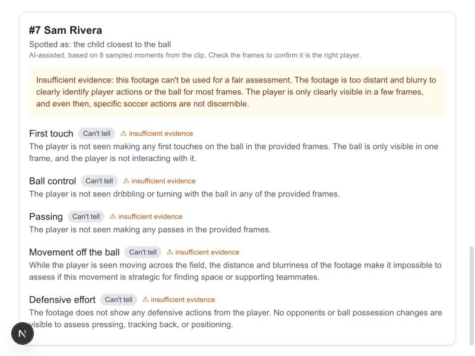

**What you see:** an amber box, *Insufficient evidence: this footage can't be used for a fair assessment*, and "Can't tell" with a ⚠ on all five criteria.

**What it does:** the first demo clip is filmed from far away. The AI said the player was too small and blurry to judge, so no ratings were made up. Plain code then double-checks the AI's answer: it deletes any observation that cites a time that was never sent, and forces "Can't tell" whenever the evidence is thin. This is the key part of **Test 3**: the app flags insufficient evidence instead of inventing observations.

---

### 7. A real evidence card
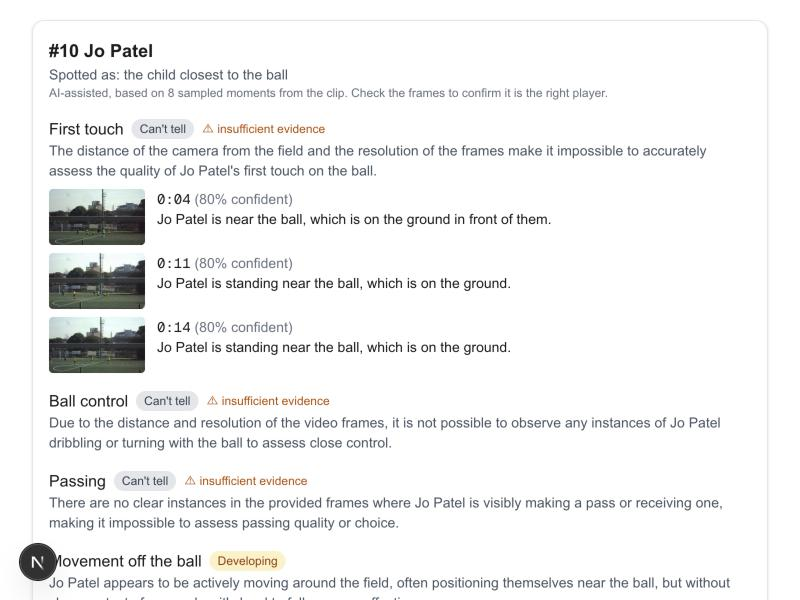

**What you see:** #10 Jo Patel from the second clip. Each observation has a timestamp (0:04, 0:11, 0:14), a confidence percentage, a thumbnail of the exact frame, and a plain sentence. "Movement off the ball" is rated *Developing*. First touch is "Can't tell", with the reason shown.

**What it does:** this is the main output (**Test 1**). The AI looks at the 8 frames and rates five fixed criteria: first touch, ball control, passing, movement off the ball, defensive effort. The thumbnail beside every observation lets the coach check that the AI looked at the right player. The line under the name says the notes are AI-assisted and based on 8 sampled moments, so nobody mistakes them for a full match review.

---

### 8. The comparison table
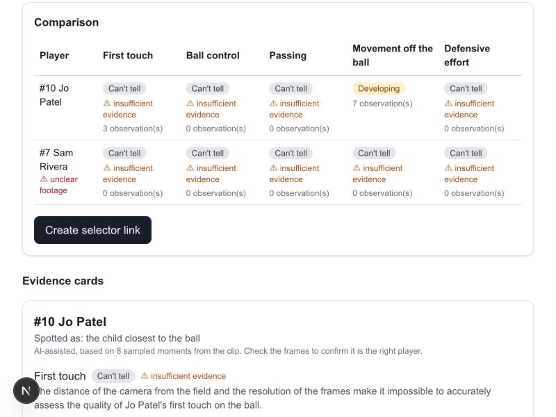

**What you see:** one row per player and the same five columns for everyone. Jo has a *Developing* rating with 7 observations. Sam is marked "unclear footage" with "Can't tell" and ⚠ in every cell.

**What it does:** after two or more players are analysed, the table lets the coach compare them fairly using the same criteria. Cells without enough evidence are flagged instead of left to look like a bad rating (**Test 2**). The observation counts show how much evidence sits behind each cell.

---

### 9. A share link is created
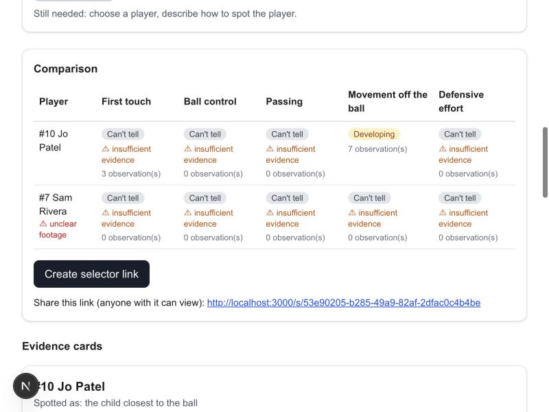

**What you see:** after pressing "Create selector link", a link appears: *Share this link (anyone with it can view).*

**What it does:** the report (table, cards and small thumbnails) is saved under a long random ID, with no accounts or logins. On a laptop it is saved to a local folder. On the hosted version it is saved to Vercel Blob storage. Anyone with the link can view it, and the page says so.

---

### 10. What a selector sees
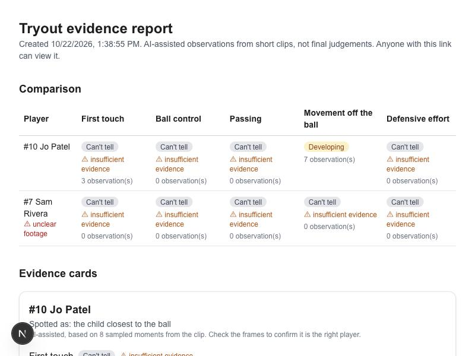

**What you see:** a clean one-page report: title, creation time, the same comparison table, then the evidence cards. It opened in a separate tab, as a selector would see it.

**What it does:** this is the shareable output (**Test 2**). It is read-only, with no upload buttons, and carries the reminder *AI-assisted observations from short clips, not final judgements.*

---

### 11. A dark clip is caught before the AI is called
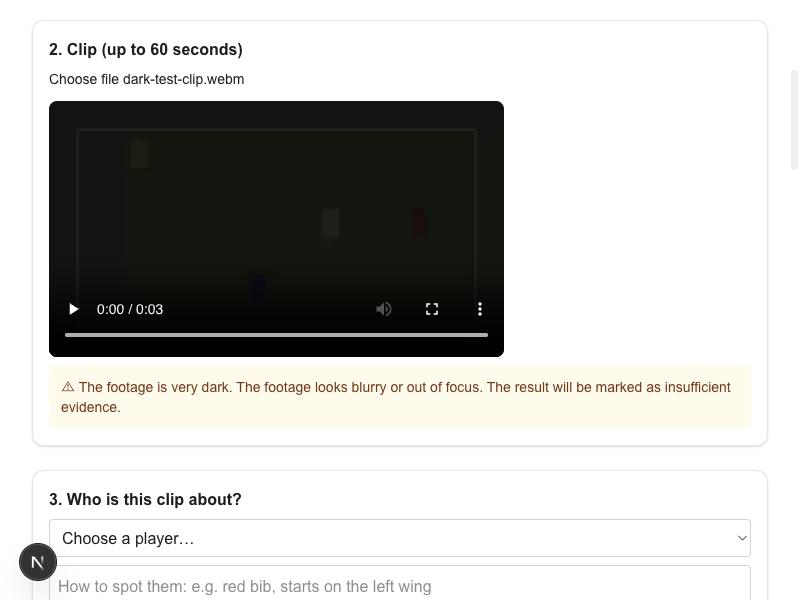

**What you see:** a very dark test clip and the warning *The footage is very dark. The footage looks blurry or out of focus. The result will be marked as insufficient evidence.*

**What it does:** ordinary code measures each clip before any AI is used: average brightness, sharpness, and shakiness (how the picture slides between frames). It warns the coach straight away and marks the result as insufficient evidence. The dark clip here was generated for testing. It is the third **Test 3** case: dark, shaky or unclear footage.

---

## How the work progressed

| Stage | What was done |
|---|---|
| 1. Setup | Checked that Node.js, git and the GitHub CLI were installed and that GitHub login worked. |
| 2. Plan | Wrote the user journey, the file list, which steps use AI and which are plain code, and how each of the 3 tests would be checked. |
| 3. Build | Next.js app with roster check, frame extraction, the AI call (key kept in `.env.local`, never in code), answer checking, comparison table, share link. |
| 4. Trim | Removed features not needed for the 3 tests, and added the "8 sampled moments" note to every card. |
| 5. Test with real clips | Ran personal phone clips, a night football clip and two kids' football clips through the real screen. |
| 6. Fix what the tests found | Stopped the AI rating non-soccer footage. Hid observations when footage is unusable. Rewrote the shake check after it missed a shaky test clip. |
| 7. Demo mode | Added one-click demo clips so anyone can try the app with no files of their own. |
| 8. Publish | Pushed to GitHub, with README and proof of work. Deployed to Vercel. |

## Honest limits

- Only 8 moments per clip are looked at, so a great pass between frames is missed. Every card says so.
- The AI can follow the wrong player, which is why the description and thumbnails are shown on each card.
- The confidence numbers are the AI's own estimate. Ratings can differ a little between runs of the same clip.
- The dark, blurry and shaky checks were tested on generated clips, not on real dark phone footage.
- The hosted Vercel version is deployed but still has to be switched to public, given its API key, and given a storage store before it can be used by others. These screenshots are from the local copy.
